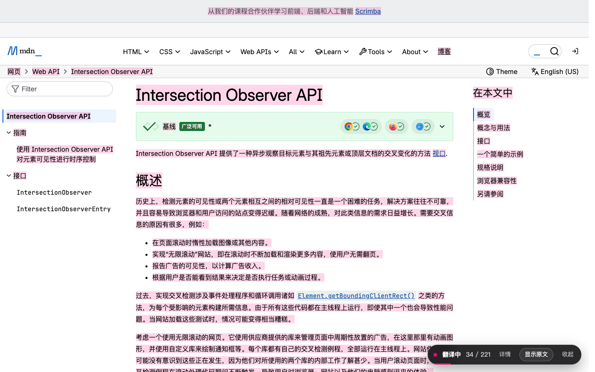

# 整页英译中

一个模仿谷歌翻译的 Chrome 扩展：整页原地翻译英文网页，跟随滚动节奏流式出译文。

## 三步启动

1. 填写密钥：把 .env.example 复制为 .env，填入 GROQ_API_KEY。
2. 安装支持命令行加载扩展的浏览器，首次执行：node_modules/.bin/playwright-core install chromium
3. 运行 just_run.sh。

上面那条命令会检查 .env、生成 src/dev_config.json、启动浏览器并打开英文样例页，然后在终端打印用法。

## 为什么需要第二条命令

官方版 Chrome 从 137 起移除命令行参数 --load-extension，142 起连绕过开关也移除，实测官方 Chrome 155 启动后扩展列表为空。just_run.sh 因此优先查找 Chrome for Testing 或 Chromium，找不到时会直接告诉你缺什么。也可以手动在 chrome://extensions 里加载已解压的扩展，效果一样。

## 核心功能

1. 整页原地翻译，只改文本节点，排版、链接、加粗、列表全部保留。
2. 滚动优先，视口内与前后各两屏优先入队，远处延后。
3. 流式写入，模型每吐一条译文就写进页面并淡红高亮。
4. 批量聚合，同区域相邻段落合并成一次请求，互相提供上下文。
5. 智能跳过，代码块、输入框、隐藏菜单、纯数字与纯链接不动。
6. 动态跟进，无限滚动与单页应用新插入的内容自动入队。
7. 译文缓存，复访直接命中，条数、占用、过期三重治理。
8. 空闲补全，小页面停止滚动后自动补完，超大页面保持懒翻译。
9. 划词翻译，选中英文浮出按钮，译文流式显示并支持复制。
10. 悬停看原文，鼠标停在译文上显示原句。
11. 站点规则，按域名设置免译与进站自动翻译，子域名同样命中。
12. 仅正文模式，只采集 article 或 main 区域，通常省一半额度。
13. 错误分类与重试，网络、限流、密钥、权限分开提示，重试只补失败段落。
14. 一键还原，原文完整保留，切回译文不消耗额度。

## 使用

1. 打开英文网页，点工具栏图标，再点翻译此页。
2. 右下角胶囊显示已译与总数，点详情看队列、缓存、失败与用时。
3. 点收起变成小圆点，点小圆点展开，状态会记住。
4. 选中英文会出现翻译选中，结果可复制。
5. 鼠标停在译文上显示原句。
6. 快捷键 Alt+Shift+T 切换译文与原文。

## 配置项

设置页每一处改动立刻生效。

1. 接口：密钥、接口地址、域名授权、模型档位、连接测试、限流余量。
2. 翻译行为：目标语言、翻译范围、采集范围、空闲补全、预取屏数、划词、悬停、高亮。
3. 性能与成本：每批段数、每批字符、并发、最大输出、温度、思考强度。
4. 站点规则：免译域名、自动翻译域名。
5. 缓存：条数上限、占用上限、过期天数、清理过期、清空。

## 权限说明

1. 主机权限只申请接口域名与本地调试地址，不持有全站数据权限。
2. 整页翻译依赖内容脚本匹配所有站点，安装提示来自这里，属于功能必需。
3. 接口地址改成自定义域名时，在设置页点授权当前接口域名，只申请该域名。
4. tabs 用于读取当前标签判断站点规则，scripting 用于页面已打开后补注入，storage 保存设置与缓存。

## 测试

全量测试不需要密钥，只有带真实接口的用例会消耗额度。

1. npm run test:mock 假接口回放，验证流式写入、保序、去重、跳过规则、还原与缓存，15 项。
2. npm run test:guards 黑名单、白名单、错误分类、重试、缓存治理、跨重启持久化、字号规范、划词、悬停、折叠、仅正文、中文页跳过，53 项。
3. npm run test:mini 真实接口小页面回归，约 1000 tokens。
4. npm run test:e2e 主样例页滚动优先、跳过规则、缓存与还原，17 项。
5. npm run test:real 真实站点 MDN，同时验证弹窗与设置页。

## 已知限制

1. 只翻译顶层文档，不进入 iframe。
2. 额度由接口账号决定，本项目实测为每分钟 8000 tokens、每天 200000 tokens。超大页面需要数分钟，期间胶囊显示真实倒计时。
3. 失效节点无法还原为最初的空白与换行差异，还原时写回扫描时保存的原始字符串。
